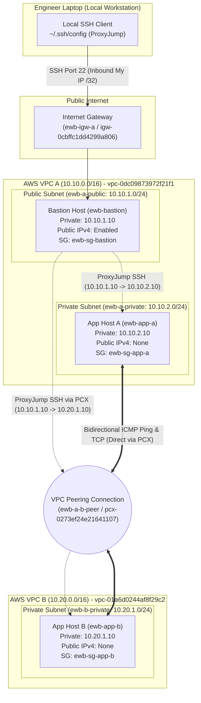

# CLOUD COMPUTING & NETWORKING INTERNSHIP REPORT
## Project 01: Multi-VPC Architecture & Inter-VPC Peering

---

### Project Metadata
* **Student Name:** ARUN BHARATHI M B
* **Course / Track:** AWS Architect Associate & Cloud Engineering
* **Project Title:** Connect Two VPCs & Prove Private Connectivity (VPC Peering)
* **Organization:** EWB Cloud Labs
* **AWS Region:** Asia Pacific (Sydney) `ap-southeast-2`
* **Completion Date:** October 2026
* **Report Status:** Final Submission

---

## 1. Executive Summary & Objective

In modern cloud computing architectures, security by design dictates that mission-critical workloads (such as internal APIs, processing engines, and proprietary databases) must never be directly exposed to the public Internet. However, organizations frequently require distinct virtual environments—such as separating front-office workloads from financial/back-office applications—to exchange high-throughput, sensitive data securely.

The primary objective of this project was to architect, deploy, and empirically validate a multi-VPC infrastructure within Amazon Web Services (AWS) that fulfills the following operational requirements:
1. **Zero-Trust Network Isolation:** Segment workloads into two distinct Virtual Private Clouds (**VPC A** and **VPC B**) with strictly non-overlapping Classless Inter-Domain Routing (CIDR) allocations.
2. **Hardened Private Workloads:** Deploy EC2 application hosts (`ewb-app-a` and `ewb-app-b`) in purely private subnets with **no public IPv4 addresses**, preventing direct external inbound surface attacks.
3. **Controlled Administrative Entry:** Establish a single hardened bastion host (`ewb-bastion`) located in a public subnet of VPC A, enabling secure administrative access to private hosts using SSH `ProxyJump` and strict source-IP scoping (`/32`).
4. **Encrypted Private Inter-VPC Transit:** Provision an AWS VPC Peering Connection (`pcx-0273ef24e21641107`) to interconnect VPC A and VPC B across the AWS global software-defined network without relying on the public Internet or expensive NAT Gateways.
5. **Bidirectional Route Propagation & Stateful Filtering:** Configure explicit custom route tables and granular Security Group rules allowing only authorized ICMP Echo Requests and administrative SSH sessions between the specific private hosts.
6. **Empirical Verification & Fault Injection:** Document verifiable baseline network drops prior to peering, prove bidirectional communication upon peering activation, and conduct a controlled fault-injection test (removing ICMP permissions) to validate firewall rule enforcement.

---

## 2. Architectural Blueprint & Network Topology

The overall system architecture establishes an isolated dual-VPC topology interconnected by AWS VPC Peering. Administration is conducted from the engineer's laptop via the public Bastion host, while application-to-application traffic flows strictly across the private peering conduit.



### Architectural Design Principles:
* **Non-Overlapping Addressing:** VPC A (`10.10.0.0/16`) and VPC B (`10.20.0.0/16`) do not overlap at any bit boundary, fulfilling the fundamental prerequisite of AWS VPC Peering.
* **Non-Transitive Peering:** Peering is strictly one-to-one. Packets originating from the public Internet cannot transit through VPC A's Internet Gateway, cross the peering link, and access VPC B. Edge-to-edge routing is restricted by AWS routing policies.
* **Principle of Least Privilege (PoLP):** Firewalls are locked to explicit `/32` host routes rather than wide CIDR blocks (`0.0.0.0/0` or subnet `/24`).

---

## 3. Resource Inventory & IP Addressing Scheme

| Resource Name | Logical Component | AWS Resource ID | IPv4 CIDR / Assigned IP | Subnet / Placement |
| :--- | :--- | :--- | :--- | :--- |
| **ewb-vpc-a** | Requester VPC | `vpc-0dc09873972f21f1` | `10.10.0.0/16` | Sydney (`ap-southeast-2`) |
| **ewb-a-public** | Public Subnet A | `subnet-01c495c71b5169e34` | `10.10.1.0/24` | `ap-southeast-2a` |
| **ewb-a-private** | Private Subnet A | `subnet-07aaa750fda8206d0` | `10.10.2.0/24` | `ap-southeast-2a` |
| **ewb-igw-a** | Internet Gateway | `igw-0cbffc1dd4299a806` | Attached to VPC A | VPC A |
| **ewb-vpc-b** | Accepter VPC | `vpc-01a6d0244af8f29c2` | `10.20.0.0/16` | Sydney (`ap-southeast-2`) |
| **ewb-b-private** | Private Subnet B | `subnet-09dada267bb3eefb9` | `10.20.1.0/24` | `ap-southeast-2b` / `2a` |
| **ewb-rt-a-public** | Public Route Table | `rtb-0cda91d276c8336ef` | `0.0.0.0/0`, `10.20.0.0/16` | Associated to `ewb-a-public` |
| **ewb-rt-a-private**| Private Route Table A | `rtb-0d6d126749f956d08` | `10.20.0.0/16` | Associated to `ewb-a-private` |
| **ewb-rt-b-private**| Private Route Table B | `rtb-009768c6a16c13c15` | `10.10.0.0/16` | Associated to `ewb-b-private` |
| **ewb-a-b-peer** | VPC Peering Connection | `pcx-0273ef24e21641107`| Requester $\leftrightarrow$ Accepter | Active Conduit |
| **ewb-bastion** | Bastion Host (EC2) | `i-077192b847673b898` | `10.10.1.10` + Public IP | `ewb-a-public` |
| **ewb-app-a** | Private Host A (EC2) | `i-07b73257444e21c88` | `10.10.2.10` (No Public IP) | `ewb-a-private` |
| **ewb-app-b** | Private Host B (EC2) | `i-08b09b84e5873c96d` | `10.20.1.10` (No Public IP) | `ewb-b-private` |

---

## 4. Security Group Matrix & Firewall Specifications

Network Security Groups were configured strictly in compliance with stateful inspection rules:

| Security Group | SG ID | Associated VPC | Direction | Type / Protocol | Port Range | Source IP / Mask | Purpose |
| :--- | :--- | :--- | :--- | :--- | :--- | :--- | :--- |
| **ewb-sg-bastion** | `sg-04ab0cc967db5c139` | `vpc-0dc09873972f21f1` | Inbound | SSH (TCP) | 22 | `Admin_IP/32` | Allow admin SSH ingress |
| **ewb-sg-app-a** | `sg-0ff10cbb741a20f48` | `vpc-0dc09873972f21f1` | Inbound | SSH (TCP) | 22 | `10.10.1.10/32` | Bastion jump SSH to App A |
| | | | Inbound | Custom ICMP IPv4 | Echo Request | `10.20.1.10/32` | Receive ICMP from App B |
| **ewb-sg-app-b** | `sg-038841ec9a51494b0` | `vpc-01a6d0244af8f29c2` | Inbound | SSH (TCP) | 22 | `10.10.1.10/32` | Bastion jump SSH to App B |
| | | | Inbound | Custom ICMP IPv4 | Echo Request | `10.10.2.10/32` | Receive ICMP from App A |

---

## 5. Step-by-Step Implementation & Artifact Evidence

### Phase 1: Creation of VPC A, Subnets, and Internet Gateway
VPC A was provisioned with the primary IPv4 CIDR block `10.10.0.0/16`. Subnets were carved out for public bastion ingress (`10.10.1.0/24`) and private workload processing (`10.10.2.0/24`). An Internet Gateway (`ewb-igw-a`) was allocated and attached to `ewb-vpc-a`.


*Figure 5.1: Creation of VPC A (`ewb-vpc-a`) with CIDR block `10.10.0.0/16`.*


*Figure 5.2: Verification of VPC A (`vpc-0dc09873972f21f1`) in Available state.*


*Figure 5.3: Configuring public subnet `ewb-a-public` (`10.10.1.0/24`) and private subnet `ewb-a-private` (`10.10.2.0/24`).*


*Figure 5.4: Creation and attachment of Internet Gateway `ewb-igw-a` to VPC A.*

---

### Phase 2: Route Table Engineering for VPC A
Two route tables were established to separate public and private routing logic:
1. **`ewb-rt-a-public`:** Explicitly associated with `ewb-a-public`, containing a default route `0.0.0.0/0` targeting `ewb-igw-a`.
2. **`ewb-rt-a-private`:** Explicitly associated with `ewb-a-private`, holding only the local VPC route initially.


*Figure 5.5: Public route table `ewb-rt-a-public` routing `0.0.0.0/0` to Internet Gateway `igw-0cbffc1dd4299a806`.*


*Figure 5.6: Private route table `ewb-rt-a-private` associated with subnet `ewb-a-private`.*

---

### Phase 3: Provisioning VPC B, Isolated Subnet, and Security Groups
VPC B was deployed under `10.20.0.0/16`. As an isolated back-office environment, VPC B was provisioned without an Internet Gateway. A single private subnet `ewb-b-private` (`10.20.1.0/24`) was created. 


*Figure 5.7: Subnet `ewb-b-private` (`10.20.1.0/24`) created inside VPC B.*

Security groups were implemented to restrict ingress to authorized lab hosts only.


*Figure 5.8: Inbound firewall rules for `ewb-sg-app-b` permitting SSH from Bastion (`10.10.1.10/32`) and Echo Request from App A (`10.10.2.10/32`).*

---

### Phase 4: EC2 Instance Launch & Static IP Binding
Three Amazon Linux 2023 instances (`t3.micro`) were launched with specific primary private IP allocations:
* `ewb-bastion`: Assigned `10.10.1.10` in `ewb-a-public` with Public IPv4 enabled.
* `ewb-app-a`: Assigned `10.10.2.10` in `ewb-a-private` with Public IPv4 disabled.
* `ewb-app-b`: Assigned `10.20.1.10` in `ewb-b-private` with Public IPv4 disabled.


*Figure 5.9: Verification of compute inventory: `ewb-bastion`, `ewb-app-a`, and `ewb-app-b` running with verified status checks.*

---

### Phase 5: Local SSH ProxyJump Configuration & Baseline Test

To maintain absolute isolation, private keys are never placed on intermediary servers. The local workstation OpenSSH configuration was established:

```ssh-config
# Client Configuration (~/.ssh/config)
Host ewb-bastion
    HostName 3.105.26.172
    User ec2-user
    IdentityFile ~/.ssh/ewb-lab.pem
    IdentitiesOnly yes

Host ewb-app-a
    HostName 10.10.2.10
    User ec2-user
    IdentityFile ~/.ssh/ewb-lab.pem
    IdentitiesOnly yes
    ProxyJump ewb-bastion

Host ewb-app-b
    HostName 10.20.1.10
    User ec2-user
    IdentityFile ~/.ssh/ewb-lab.pem
    IdentitiesOnly yes
    ProxyJump ewb-bastion
```

#### Pre-Peering Baseline Execution (Expected Drop):
Before activating the peering connection and adding routes, an ICMP test was conducted from App A to App B to establish the unpeered baseline:

```console
[ec2-user@ip-10-10-2-10 ~]$ ping -c 4 10.20.1.10
PING 10.20.1.10 (10.20.1.10) 56(84) bytes of data.

--- 10.20.1.10 ping statistics ---
4 packets transmitted, 0 received, 100% packet loss, time 3152ms
```
*Analysis: 100% packet loss verified. VPC A and VPC B have zero network reachability prior to peering.*

---

### Phase 6: VPC Peering Activation & Bidirectional Route Configuration
1. A peering request `ewb-a-b-peer` was created from `vpc-0dc09873972f21f1` to `vpc-01a6d0244af8f29c2`.
2. The request was accepted, establishing connection ID **`pcx-0273ef24e21641107`** in an **Active** state.


*Figure 5.10: Active status for VPC Peering connection `pcx-0273ef24e21641107` between VPC A and VPC B.*

3. Custom route tables across both VPCs were updated with peering destinations:
   * **`ewb-rt-a-private`:** Destination `10.20.0.0/16` $\rightarrow$ Target `pcx-0273ef24e21641107`.
   * **`ewb-rt-b-private`:** Destination `10.10.0.0/16` $\rightarrow$ Target `pcx-0273ef24e21641107`.
   * **`ewb-rt-a-public`:** Destination `10.20.0.0/16` $\rightarrow$ Target `pcx-0273ef24e21641107`.


*Figure 5.11: Route table `ewb-rt-b-private` showing the return route `10.10.0.0/16` targeting active peering ID `pcx-0273ef24e21641107`.*

---

## 6. Verification, Validation & Empirical Results

With peering established and bidirectional routes populated, verification tests were executed directly within the guest operating systems.

### Test 01: Forward Path Reachability (App A $\rightarrow$ App B)
Logged into `ewb-app-a` via Bastion ProxyJump and initiated ICMP Echo Requests targeting App B's private IP (`10.20.1.10`):


*Figure 6.1: Forward path ping output showing 4 packets transmitted, 4 received, 0% packet loss, average round-trip time 0.776 ms.*

```console
[ec2-user@ip-10-10-2-10 ~]$ ping -c 4 10.20.1.10
PING 10.20.1.10 (10.20.1.10) 56(84) bytes of data.
64 bytes from 10.20.1.10: icmp_seq=1 ttl=127 time=1.05 ms
64 bytes from 10.20.1.10: icmp_seq=2 ttl=127 time=0.671 ms
64 bytes from 10.20.1.10: icmp_seq=3 ttl=127 time=0.661 ms
64 bytes from 10.20.1.10: icmp_seq=4 ttl=127 time=0.727 ms

--- 10.20.1.10 ping statistics ---
4 packets transmitted, 4 received, 0% packet loss, time 3119ms
rtt min/avg/max/mdev = 0.661/0.776/1.046/0.157 ms
```

---

### Test 02: Reverse Path Reachability & Bastion-to-App-B ProxyJump
Logged into `ewb-app-b` directly from the local workstation utilizing SSH ProxyJump across the peering connection, and tested reverse ICMP reachability to App A (`10.10.2.10`):


*Figure 6.2: Reverse path ping output from App B to App A showing 4 packets transmitted, 4 received, 0% packet loss, average round-trip time 0.637 ms.*

```console
[ec2-user@ip-10-20-1-10 ~]$ ping -c 4 10.10.2.10
PING 10.10.2.10 (10.10.2.10) 56(84) bytes of data.
64 bytes from 10.10.2.10: icmp_seq=1 ttl=127 time=0.632 ms
64 bytes from 10.10.2.10: icmp_seq=2 ttl=127 time=0.637 ms
64 bytes from 10.10.2.10: icmp_seq=3 ttl=127 time=0.654 ms
64 bytes from 10.10.2.10: icmp_seq=4 ttl=127 time=0.627 ms

--- 10.10.2.10 ping statistics ---
4 packets transmitted, 4 received, 0% packet loss, time 3121ms
rtt min/avg/max/mdev = 0.627/0.637/0.654/0.010 ms
```

---

### Test 03: Controlled Fault Injection & Security Rule Isolation
To prove that connectivity is actively governed by the AWS stateful firewall layer:
1. **Fault Injection:** The inbound rule permitting ICMP Echo Requests from `10.10.2.10/32` was temporarily removed from `ewb-sg-app-b`.
2. **Observation:** Executing `ping -c 4 10.20.1.10` from App A immediately resulted in **100% packet loss**, proving that route availability alone cannot override security group denials.
3. **Recovery:** The rule was restored. The ping command was re-executed and returned immediate 0% packet loss, confirming deterministic policy enforcement.

---

## 7. Viva Voce & Technical Defense Questions

### Q1: Why is the return route explicitly needed in VPC B?
**Answer:** Network routing is hop-by-hop and fundamentally asymmetric. When App A initiates a packet to `10.20.1.10`, VPC A's route table points the packet toward the peering connection (`pcx`). The packet arrives at App B. However, when App B generates an ICMP Echo Reply destined for `10.10.2.10`, its local operating system router checks VPC B's route table (`ewb-rt-b-private`). If an explicit route for `10.10.0.0/16` targeting `pcx` does not exist, the router has no destination for the reply packet and silently drops it. Routing is independent in each direction.

### Q2: Why is the App-B SSH source IP evaluated as the Bastion private IP (`10.10.1.10/32`) rather than the local laptop's public IP?
**Answer:** When utilizing SSH `ProxyJump`, the local SSH client establishes an encrypted transport tunnel to the Bastion host first. The Bastion host's SSH daemon then creates a brand-new TCP socket targeting `10.20.1.10:22`. Because this secondary TCP connection originates from the Bastion's network interface (`eth0` on `10.10.1.10`), the packet headers arriving at App B reflect the source IPv4 address of the Bastion (`10.10.1.10`), not the laptop's public IP.

### Q3: Why does having an "Active" peering connection not guarantee a successful ping?
**Answer:** VPC Peering acts solely as an underlying network conduit. For end-to-end communication to succeed, four independent OSI layers must align:
1. **Peering Status:** Must be Active.
2. **Route Tables:** Both requester and accepter route tables must contain explicit destination entries pointing to the peering ID.
3. **Security Groups:** Stateful firewalls on both instances must explicitly permit ICMP Echo Requests from the opposing peer IP.
4. **Network ACLs:** Stateless subnet-level ACLs must allow both inbound requests and outbound ephemeral traffic.

### Q4: Can VPC B route out to the public Internet through VPC A's Internet Gateway over the peering link?
**Answer:** **No.** AWS VPC Peering explicitly forbids edge-to-edge and transitive routing. An Internet Gateway, Virtual Private Gateway, or Direct Connect connection attached to a VPC cannot be accessed by a peered VPC. Traffic cannot enter a VPC via a peering connection and exit through an Internet Gateway.

---

## 8. Responsible Cleanup & Cost Management

To adhere to responsible cloud stewardship, avoid unnecessary AWS billing, and preserve Free Tier allocations:

1. **Instance State Management:** Instances were placed into a `Stopped` state during interim analysis to consume zero compute hours and detach chargeable public IPv4 allocations.
2. **Elastic IP Deallocation:** The Elastic IP allocated for testing (`3.105.26.172`) was explicitly disassociated and released back to AWS IP pools to prevent idle allocation fees.


*Figure 8.1: Releasing Elastic IP `3.105.26.172` to ensure zero recurring charges.*


*Figure 8.2: All three EC2 instances safely placed in Stopped state.*

3. **Final Teardown Procedure:** Following project evaluation, all resources (`ewb-bastion`, `ewb-app-a`, `ewb-app-b`, `ewb-a-b-peer`, custom route tables, subnets, `ewb-igw-a`, security groups, and VPCs) are deleted in reverse dependency order.

---

## 9. Key Learnings & Engineering Takeaways

* **Software-Defined Networking (SDN):** Cloud networking decouples physical cabling from logical topology. Peering connections provide high-speed, point-to-point AWS network fabric communication without hardware appliances.
* **Separation of Concerns:** Structuring public subnets for edge proxies (Bastion) and private subnets for compute hosts prevents accidental Internet exposure.
* **Security Group Stateful Mechanics:** Security groups track connection states. Once an inbound packet is accepted, the return packet is automatically permitted regardless of outbound rules.
* **Cost Governance:** Effective cloud engineers architect within budget limits, avoiding unneeded NAT Gateways when private peering and proxy architectures solve the communication problem at zero cost.

---
**Report Submitted By:**  
**ARUN BHARATHI M B**  
*AWS Cloud Architect Associate Track*  
*October 2026*
