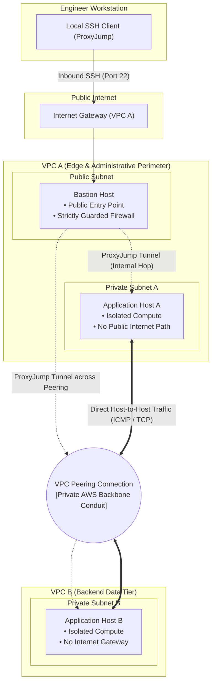

# AWS VPC Peering: Architecture & Workflow Guide

## 1. Project Overview & Architectural Intent
The goal of this architecture is to establish secure, high-throughput private communication between two distinct Virtual Private Clouds (**VPC A** and **VPC B**) without exposing backend compute resources to the public Internet.

Instead of routing traffic over external networks or deploying costly transit appliances, the architecture leverages native **AWS VPC Peering**. This enables instances across separate virtual networks to communicate directly using private addressing across Amazon's software-defined global network backbone.



---

## 2. Structural Components & Roles

### 1. VPC A (The Edge & Management Perimeter)
* **Public Subnet:** Houses the **Bastion Host**. It is explicitly bound to an Internet Gateway to permit inbound administrative access.
* **Private Subnet:** Houses **Application Host A**. It has no route to the Internet Gateway, ensuring complete isolation from external web traffic.
* **Internet Gateway (IGW):** Attached exclusively to VPC A. It serves as the single controlled front door for administrator ingress.

### 2. VPC B (The Isolated Backend Tier)
* **Completely Private Enclave:** VPC B has **no Internet Gateway**. 
* **Private Subnet:** Houses **Application Host B**. 
* Instances inside VPC B can never receive traffic from the public Internet, nor can they initiate external connections directly.

### 3. VPC Peering Conduit
* A direct, point-to-point logical link connecting the virtual network routers of VPC A and VPC B.
* Acts as a dedicated private conduit that routes inter-VPC traffic without packet encapsulation, proxy bottlenecks, or bandwidth throttling.

---

## 3. End-to-End Operational Workflow

The implementation and operational lifecycle follows seven sequential stages:

```
[Phase 1: Partitioning] ──► [Phase 2: Gateways & Routes] ──► [Phase 3: Host Hardening]
    Network isolation           Default routing logic           Firewall definitions
                                                                      │
[Phase 6: Verification] ◄── [Phase 5: Route Injection]  ◄── [Phase 4: Peering Conduit]
    Testing & failure tests     Bidirectional road signs        Request & acceptance
```

### Phase 1: Network Partitioning
* Two distinct VPCs are created with non-overlapping address boundaries.
* Subnets are provisioned within designated Availability Zones to separate public-facing entry points from internal compute runtimes.

### Phase 2: Edge Ingress & Baseline Route Tables
* An Internet Gateway is attached to VPC A to service the public subnet.
* A **Public Route Table** is associated with the public subnet, directing default outbound traffic to the Internet Gateway.
* **Private Route Tables** are associated with the private subnets. At inception, they contain only internal local routes, ensuring workloads cannot reach external destinations or each other.

### Phase 3: Compute Provisioning & Firewall Hardening
* Compute instances are deployed across the subnets:
  * **Bastion Host:** Given a public address and placed in the public subnet.
  * **App Host A & App Host B:** Deployed in their respective private subnets with **no public addresses**.
* **Security Group Policies (Principle of Least Privilege):**
  * Bastion firewall permits administrative SSH access exclusively from the administrator's authorized workstation.
  * Private application firewalls reject all inbound traffic from the outside world, permitting traffic only from the Bastion host and the designated peer application instance.

### Phase 4: Establishing the Peering Conduit
* A VPC Peering Request is initiated from VPC A (Requester) targeting VPC B (Accepter).
* The connection request is accepted, activating the private software-defined bridge between both VPC virtual routers.
* *Note:* At this stage, the bridge exists, but no traffic can cross because the routers have not yet been told how to direct packets to it.

### Phase 5: Bidirectional Route Injection
* Routing in software-defined networks is hop-by-hop and asymmetric. For two hosts to communicate, routes must be injected into the route tables on both sides:
  * **Forward Route:** Injected into VPC A's private route table, instructing routers to forward any packet destined for VPC B's network range into the Peering Connection.
  * **Return Route:** Injected into VPC B's private route table, directing return packets destined for VPC A back through the Peering Connection.
  * **Management Route:** Injected into the public subnet's route table, enabling the Bastion host to open sessions to VPC B hosts across the peering link.

### Phase 6: Connectivity Verification & Fault Injection
1. **Pre-Peering Baseline Drop:** Connectivity is tested prior to route configuration; all packets are dropped, confirming initial network isolation.
2. **Forward & Reverse Path Validation:** Traffic is transmitted from App A to App B, and reverse traffic is verified from App B to App A, demonstrating two-way reachability.
3. **Administrative Access via ProxyJump:** The administrator connects to the private hosts from their local machine by jumping through the Bastion host in memory, without copying private keys to the cloud.
4. **Controlled Fault Injection:** A firewall rule is temporarily removed to verify that security group policies actively police traffic even when routing paths are fully operational.

### Phase 7: Responsible Lifecycle Management
* Non-persistent testing assets (such as compute instances and dynamic ingress allocations) are stopped or terminated following validation to eliminate idle cloud costs while preserving architectural integrity.

---

## 4. Key Architectural Rules

1. **Non-Transitive Routing:**
   * VPC Peering does **not** support transitivity ($A \leftrightarrow B$ and $B \leftrightarrow C$ does not connect $A \leftrightarrow C$).
   * Peering cannot be used as a passthrough to the Internet. Traffic from VPC B cannot traverse the peering link to exit out of VPC A's Internet Gateway.
2. **Multi-Layer Enforcement:**
   * Reachability requires both the **network routing layer** (Route Tables) and the **firewall layer** (Security Groups and Network ACLs) to explicitly authorize the communication path.
3. **Secure Perimeter Ingress:**
   * Workloads remain unexposed to public threats by keeping them entirely private and tunneling administration through a hardened Bastion proxy.
